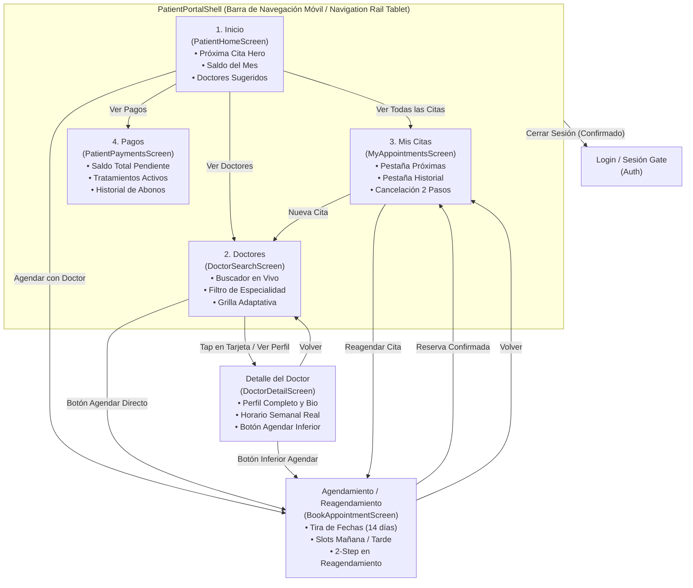
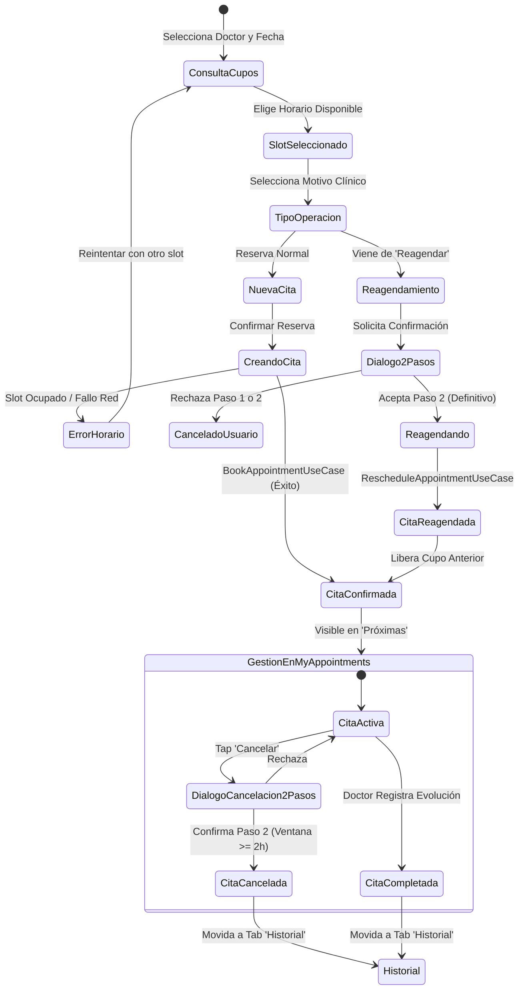
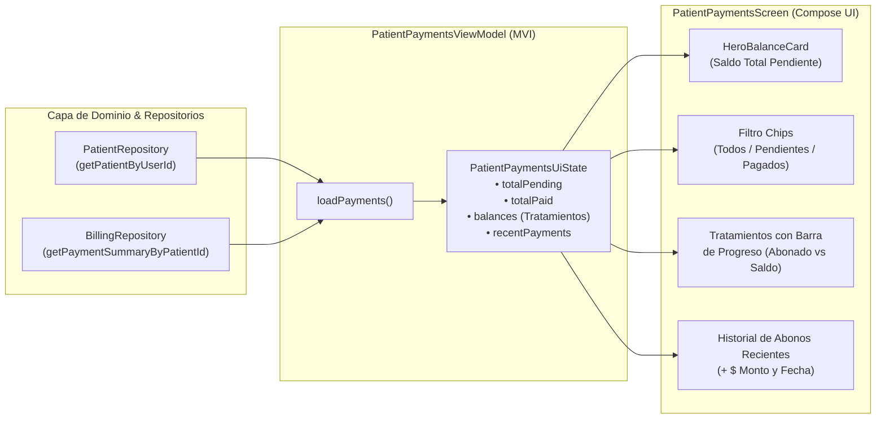

# Plan Maestro de Auditoría UI/UX, Accesibilidad, Insets y Arquitectura: Portal del Paciente (Biodontos)

**Documento Oficial de Auditoría y Especificación de Refactorización**  
**Versión:** 1.0.0 — Octubre 2026  
**Autor:** Auditor UI/UX & Planificador de Arquitectura (Subagente `spec_miner_ws2_1`)  
**Dirigido a:** Orquestador de Proyecto Biodontos, Agentes Implementadores y Equipo de Calidad Clínica  
**Entorno:** Kotlin 2.0+ / Android 16 (API 36 Edge-to-Edge) / Jetpack Compose BOM / Clean Architecture + MVI  

---

## 1. Resumen Ejecutivo y Alcance de la Auditoría

El **Portal del Paciente** de Biodontos representa la interfaz crítica entre el paciente y la plataforma odontológica, soportando el ciclo completo de atención: consulta de especialistas, reserva y reagendamiento de citas, visualización de historial clínico y trazabilidad financiera de abonos.

Esta auditoría exhaustiva examinó el 100% de los 7 archivos objetivo de presentación del paciente, sus ViewModels asociados, contratos de estado y componentes del sistema de diseño:

1. **Shell y Navegación Principal:** [`PatientPortalShell.kt`](file:///c:/Users/DELL/AndroidStudioProjects/Biodontos/app/src/main/java/com/example/biodontos/presentation/patientportal/shell/PatientPortalShell.kt)
2. **Dashboard de Inicio del Paciente:** [`PatientHomeScreen.kt`](file:///c:/Users/DELL/AndroidStudioProjects/Biodontos/app/src/main/java/com/example/biodontos/presentation/patientportal/home/PatientHomeScreen.kt)
3. **Directorio y Búsqueda de Especialistas:** [`DoctorSearchScreen.kt`](file:///c:/Users/DELL/AndroidStudioProjects/Biodontos/app/src/main/java/com/example/biodontos/presentation/patientportal/doctors/DoctorSearchScreen.kt)
4. **Detalle y Perfil del Especialista:** [`DoctorDetailScreen.kt`](file:///c:/Users/DELL/AndroidStudioProjects/Biodontos/app/src/main/java/com/example/biodontos/presentation/patientportal/doctors/DoctorDetailScreen.kt)
5. **Gestión de Citas (Próximas e Historial):** [`MyAppointmentsScreen.kt`](file:///c:/Users/DELL/AndroidStudioProjects/Biodontos/app/src/main/java/com/example/biodontos/presentation/patientportal/appointments/MyAppointmentsScreen.kt)
6. **Agendamiento y Reagendamiento de Citas:** [`BookAppointmentScreen.kt`](file:///c:/Users/DELL/AndroidStudioProjects/Biodontos/app/src/main/java/com/example/biodontos/presentation/patientportal/appointments/BookAppointmentScreen.kt)
7. **Estado de Cuenta y Abonos:** [`PatientPaymentsScreen.kt`](file:///c:/Users/DELL/AndroidStudioProjects/Biodontos/app/src/main/java/com/example/biodontos/presentation/patientportal/payments/PatientPaymentsScreen.kt)

### Principales Hallazgos Globales:
- **Cumplimiento de Insets y Edge-to-Edge (Android 16):** La arquitectura actual presenta inconsistencias en `Scaffold` anidados que carecen de `contentWindowInsets = WindowInsets(0, 0, 0, 0)`, listas sin padding inferior adecuado frente a `BiodontosBottomActionBar`, y ausencia de `.imePadding()` en pantallas con campos de búsqueda.
- **Accesibilidad y Áreas Táctiles (WCAG 2.5.5):** Múltiples chips de filtro (especialidades, pestañas, horarios de cita y filtros de pago) presentan alturas táctiles de 24.dp a 33.dp, violando la regla innegociable de `>= 48.dp` de área interactiva mínima y careciendo de feedback háptico.
- **Tipografía y Tokens de Diseño:** Se detectaron **19 violaciones directas** de tipografía con tamaños de `11.sp` (el estándar mínimo del proyecto es `12.sp`) y **11 instancias de colores hexadecimales hardcodeados** fuera del catálogo de `DentalTheme` / `Color.kt`.
- **Integridad de Datos y Seguridad Clínica:** 
  - Se identificaron estados de error silenciosos: en `MyAppointmentsScreen`, un fallo de red o de sesión se disfraza como "No tienes citas próximas", ocultando el error al paciente.
  - En `BookAppointmentScreen`, el **reagendamiento de citas clínicas** carece del diálogo de confirmación de 2 pasos con resumen de impacto estipulado en `GEMINI.md §4.1`, modificando la agenda médica de forma inmediata.
  - En `PatientHomeScreen`, la tarjeta de doctores exhibe un badge falso "Disponible hoy" de manera estática y contiene callbacks huérfanos que no ejecutan ninguna acción.

---

## 2. Matriz de Severidad (Registro de Defectos)

| ID | Archivo | Línea(s) | Severidad | Categoría | Descripción del Defecto | Impacto Clínico / UX | Prescripción de Remediación |
| :--- | :--- | :---: | :---: | :---: | :--- | :--- | :--- |
| **PP-01** | `MyAppointmentsScreen.kt` | 168-207 | **CRÍTICA** | Integridad de Datos | Fallo de red/sesión oculto: si `loadAppointments()` falla, la condición `activeList.isEmpty()` intercepta el renderizado y muestra "No tienes citas agendadas" en vez del mensaje de error y botón de reintento. | El paciente cree erróneamente que no tiene citas programadas o que fueron eliminadas, pudiendo faltar a sus citas reales. | Reordenar ramas del `when`: evaluar `state.errorMessage != null` antes de `activeList.isEmpty()`, renderizando banner de error con botón "Reintentar". |
| **PP-02** | `BookAppointmentScreen.kt` | 121-134 | **CRÍTICA** | Seguridad Clínica | Reagendamiento de cita sin confirmación de 2 pasos: pulsar "Confirmar Reagendamiento" muta inmediatamente la agenda clínica sin advertencia de liberación del cupo anterior. | Violación de `GEMINI.md §4.1`. Un toque accidental libera el horario anterior del especialista sin posibilidad de reversión inmediata. | Integrar `TwoStepConfirmationDialog` cuando `isRescheduling == true`, mostrando resumen de impacto (fecha/hora anterior vs. nueva) antes de ejecutar el caso de uso. |
| **PP-03** | `DoctorDetailScreen.kt` | 183-350 | **ALTA** | Insets & UI | `LazyColumn` sin padding inferior para `BiodontosBottomActionBar`: el contenido inferior del horario semanal queda solapado y oculto detrás de la barra fija de reserva. | El paciente no puede leer completamente el horario de los viernes o sábados en pantallas compactas. | Añadir `contentPadding = PaddingValues(bottom = 88.dp)` a `LazyColumn` y declarar `contentWindowInsets = WindowInsets(0, 0, 0, 0)` en el `Scaffold`. |
| **PP-04** | `DoctorSearchScreen.kt` | 94-153 | **ALTA** | Insets & IME | Ausencia de `.imePadding()` en la búsqueda: al abrir el teclado virtual sobre el campo de texto, los resultados de la grilla quedan tapados sin elevación. | Dificulta la selección de doctores mientras se escribe, obligando a cerrar manualmente el teclado. | Encadenar `.consumeWindowInsets(innerPadding).imePadding()` en el contenedor principal de `DoctorSearchScreen`. |
| **PP-05** | `PatientHomeScreen.kt` | 108-116 | **ALTA** | Integridad de Datos | `state.errorMessage` nunca se renderiza en la pantalla de inicio; si la carga de dashboard falla, el paciente ve componentes vacíos sin opción de reintento. | Estado de falla silenciosa sin recuperación guiada para el usuario. | Renderizar banner de error reactivo bajo el Header con botón de reintento conectado a `PatientHomeUiEvent.Refresh`. |
| **PP-06** | `PatientHomeScreen.kt` | 580-585 | **ALTA** | Integridad de Datos | Badge "Disponible hoy" hardcodeado: se asigna estáticamente a cualquier doctor que aparezca primero, sin validar su agenda real. | Falsa expectativa clínica: el paciente asume atención inmediata cuando el doctor puede no tener cupos disponibles hoy. | Validar disponibilidad real mediante `doctor.isAvailableToday` o remover el badge si no hay slots el día en curso. |
| **PP-07** | `PatientHomeScreen.kt` | 173, 184, 496 | **ALTA** | UX & Callbacks | Botón "Ir a documentos" inoperante (`onGoToRecords = {}`) y callback `onSeeAllDoctors` huérfano en `DoctorsCard` (no está vinculado a ningún componente visual). | Frustración de usuario al interactuar con botones "muertos" que no desencadenan ninguna acción. | Conectar `onGoToRecords` hacia la pestaña de Historial de `MyAppointments` y añadir botón explícito "Ver todos" en la cabecera de `DoctorsCard`. |
| **PP-08** | `DoctorSearchScreen.kt` | 166-176 | **ALTA** | Accesibilidad | Chips de especialidad con área táctil deficiente (32.dp de alto) y sin feedback háptico. | Dificultad de pulsación para pacientes con motricidad reducida o en pantallas pequeñas (falla WCAG 2.5.5). | Establecer `Modifier.defaultMinSize(minHeight = 48.dp)` y ejecutar `haptic.performHapticFeedback(HapticFeedbackType.TextHandleMove)`. |
| **PP-09** | `MyAppointmentsScreen.kt` | 256-277 | **ALTA** | Accesibilidad | Selector de pestañas (`TabItem`) con altura de ~33.dp (< 48.dp) y sin respuesta háptica. | Violación de área táctil mínima recomendada para navegación principal. | Ajustar padding y contenedor a un mínimo de 48.dp con activación de feedback háptico al cambiar entre "Próximas" e "Historial". |
| **PP-10** | `BookAppointmentScreen.kt` | 377-391, 460-487 | **ALTA** | Accesibilidad | Chips de motivos de consulta (28.dp) y bloques horarios `SlotChip` (33.dp) por debajo de los 48.dp mínimos requeridos. | Errores frecuentes de selección de horario al pulsar entre casillas adyacentes estrechas. | Aplicar `defaultMinSize(minHeight = 48.dp)` y haptic feedback en la selección de horarios y motivos. |
| **PP-11** | `PatientPaymentsScreen.kt` | 348-363 | **ALTA** | Accesibilidad | Filtros de estado de abonos (`PaymentFilter`) con altura táctil de apenas 24.dp a 28.dp. | Alta tasa de pulsación errónea entre "Todos", "Pendientes" y "Pagados". | Elevar área táctil a 48.dp mediante `Modifier.defaultMinSize(minHeight = 48.dp)`. |
| **PP-12** | `PatientPaymentsScreen.kt` | 225-231 | **MEDIA** | Navegación / UX | Botón de retroceso (flecha atrás) presente en la cabecera cuando se accede desde la barra inferior de navegación. | Confusión de navegación: presionar "Atrás" en un destino raíz de la barra de navegación provoca un comportamiento inconsistente en la pila de pantallas. | Mostrar la flecha atrás únicamente si la pantalla fue abierta como subflujo (ej. desde el enlace directo del Dashboard de Inicio). |
| **PP-13** | `DoctorDetailScreen.kt` | 332-337 | **MEDIA** | Integridad de Datos | Horario semanal falso por defecto ("Lunes a Viernes 8am-12pm y 2pm-6pm") si el doctor no tiene agenda registrada. | Desinformación al paciente sobre los días reales de atención de especialistas externos. | Sustituir el texto inventado por un mensaje clínico informativo: "Horarios sujetos a programación clínica. Consulta cupos al agendar". |
| **PP-14** | `PatientPortalShell.kt` | 218, 241 | **MEDIA** | Tipografía | Fuentes de `11.sp` en etiquetas de la barra inferior de navegación (`NavigationBarItem`). | Infracción de legibilidad en dispositivos de alta densidad y del estándar del proyecto (>= 12.sp). | Incrementar a `12.sp` con `FontWeight.SemiBold`. |
| **PP-15** | `PatientHomeScreen.kt` | 240, 419, 476, 524, 582 | **MEDIA** | Tipografía | 5 encabezados y subtítulos con tamaño de `11.sp` ("AGENDA", "PAGOS", "HISTORIA CLÍNICA", "TUS DOCTORES", "Disponible hoy"). | Letra excesivamente reducida que incumple las guías de diseño clínico de Biodontos. | Estandarizar a `12.sp` con `letterSpacing = 1.sp` y peso `Bold`. |
| **PP-16** | `DoctorSearchScreen.kt` | 101 | **MEDIA** | Tipografía | Etiqueta de sección "DOCTORES" a `11.sp`. | Infracción de escala tipográfica mínima. | Ajustar a `12.sp`. |
| **PP-17** | `DoctorDetailScreen.kt` | 287, 325 | **MEDIA** | Tipografía | Subtítulos "ACERCA DEL ESPECIALISTA" y "HORARIO DE ATENCIÓN" en `11.sp`. | Infracción de escala tipográfica mínima. | Ajustar a `12.sp`. |
| **PP-18** | `MyAppointmentsScreen.kt` | 116 | **MEDIA** | Tipografía | Etiqueta "AGENDA" a `11.sp`. | Infracción de escala tipográfica mínima. | Ajustar a `12.sp`. |
| **PP-19** | `BookAppointmentScreen.kt` | 230, 264, 363, 445 | **MEDIA** | Tipografía | Pasos 1, 2, 3 y nombre del día en el selector de fecha formateados en `11.sp`. | Infracción de escala tipográfica mínima. | Ajustar a `12.sp`. |
| **PP-20** | `PatientPaymentsScreen.kt` | 236, 293, 429, 444, 563, 606 | **MEDIA** | Tipografía | 6 textos en `11.sp` (insignias "PAGADO", "PENDIENTE", encabezados y nota legal). | Infracción de escala tipográfica mínima. | Incrementar todos a `12.sp`. |
| **PP-21** | `PatientPaymentsScreen.kt` | 439, 446, 462, 478, 533, 583, 665 | **MEDIA** | Colores Hardcodeados | 7 colores hexadecimales directos (`Color(0xFFFFF3E0)`, `Color(0xFFE65100)`, `Color(0xFFE7EAF1)`, `Color(0xFFD32F2F)`, etc.). | Rompe la consistencia cromática, impide soporte a modo oscuro y dificulta el mantenimiento centralizado. | Migrar a tokens oficiales: `Ambar`, `BiodontosErrorRed`, `BiodontosInputBg`, `BiodontosCardTop` y `Carmesi`. |
| **PP-22** | `DoctorDetailScreen.kt` | 96, 244 | **MEDIA** | Colores Hardcodeados | Colores directos `Color(0xFFE9E9EB)` y `Color(0xFF2E7D32)`. | Inconsistencia con el sistema de diseño. | Sustituir por `BiodontosScreenBgTop` y `StatusConfirmed` de `Color.kt`. |
| **PP-23** | `PatientHomeScreen.kt` | 106 | **MEDIA** | Responsividad | Parámetro `isExpanded: Boolean = true` por defecto en `PatientHomeScreen`, sin resolverse en `PatientHomeRoute`. | En móviles verticales provoca que se renderice el layout horizontal de tablet, apretando las tarjetas de forma ilegible. | Resolver dinámicamente con `LocalConfiguration.current.screenWidthDp >= 600` en `PatientHomeRoute`. |
| **PP-24** | `DoctorSearchScreen.kt`, `DoctorDetailScreen.kt`, `PatientHomeScreen.kt` | Varios | **BAJA** | Identidad Visual | Los avatares de doctores renderizan siempre el icono genérico `Icons.Default.Person`, ignorando la propiedad `doctor.photoUrl`. | Experiencia visual impersonal que desaprovecha las fotos de perfil cargadas por los especialistas. | Integrar renderizado de imagen si `doctor.photoUrl` está presente (con soporte Base64 o AsyncImage) con fallback al avatar de iniciales. |

---

## 3. Hallazgos Detallados por Dimensión

### 3.1. Jerarquía Visual, Consistencia con DentalTheme y Tipografía

#### Regla de Tipografía Mínima (>= 12.sp)
En las pautas clínicas de Biodontos, la información médica, fechas de procedimientos, horarios y estados no pueden representarse con fuentes inferiores a `12.sp` para prevenir errores de lectura en ambientes con iluminación clínica variable o por pacientes de edad avanzada.
- Se registraron **19 ocurrencias de `11.sp`** distribuidas en los 7 archivos.
- Todas corresponden a etiquetas de paso ("1. SELECCIONA LA FECHA"), badges de estado ("PAGADO", "PENDIENTE") y nombres de sección en mayúsculas ("AGENDA", "PAGOS").
- **Solución Estándar:** Migrar a `fontSize = 12.sp`, compensando la jerarquía mediante `FontWeight.Bold`, `letterSpacing = 1.sp` y los colores semánticos `BiodontosGreyText` o `BiodontosDark`.

#### Eliminación de Colores Hardcodeados
El archivo `Color.kt` provee un conjunto completo de tokens para el portal de pacientes (`BiodontosScreenGradient`, `BiodontosCardGradient`, `BiodontosCardTop`, `BiodontosSlateBlue`, `StatusConfirmed`, `StatusPending`, `StatusCancelled`, `Carmesi`, `Ambar`).
- `PatientPaymentsScreen.kt` contiene la mayor concentración de colores crudos:
  - `Color(0xFFFFF3E0)` y `Color(0xFFE65100)` para estados pendientes -> Reemplazar por token `Ambar` con alpha de fondo.
  - `Color(0xFFD32F2F)` para saldo deudor o error -> Reemplazar por `BiodontosErrorRed` o `Carmesi`.
  - `Color(0xFFF7F8FA)` y `Color(0xFFF0F4FA)` para tarjetas de detalle -> Reemplazar por `BiodontosCardTop` y `BiodontosLightGrey`.

---

### 3.2. Integridad de Datos y Manejo de Estados

#### Estados de Error Silenciosos y Falta de Reintento
- **`MyAppointmentsScreen` (Defecto Crítico PP-01):** La estructura del condicional de renderizado es:
  ```kotlin
  // ESTADO ACTUAL DEFECTUOSO
  when {
      state.isLoading -> { CircularProgressIndicator(...) }
      activeList.isEmpty() -> { Text("No tienes citas próximas agendadas") }
      else -> { LazyColumn(...) }
  }
  ```
  Si la llamada al repositorio falla por desconexión o sesión expirada, `activeList` permanece vacía y `state.errorMessage` almacena el fallo. Sin embargo, el bloque entra en `activeList.isEmpty()`, engañando al paciente al decirle que no tiene citas cuando en realidad la consulta falló.
  - **Corrección Mandatoria:**
  ```kotlin
  // ESTADO CORREGIDO
  when {
      state.isLoading -> { CircularProgressIndicator(...) }
      state.errorMessage != null && activeList.isEmpty() -> {
          ErrorCardWithRetry(
              message = state.errorMessage,
              onRetry = { onEvent(MyAppointmentsUiEvent.Refresh) }
          )
      }
      activeList.isEmpty() -> { EmptyAppointmentsCard(...) }
      else -> { LazyColumn(...) }
  }
  ```

- **`BookAppointmentViewModel` (Slots y Doctor):**
  Si `getAvailableSlotsUseCase` o `doctorRepository.getDoctorById` devuelven fallo, el error no se propaga a la vista. El paciente ve "No hay horarios disponibles para esta fecha" o una pantalla sin cabecera médica, sin enterarse de que el servicio de agenda falló.

#### Datos Simulados / Hardcodeados
- En `PatientHomeScreen.kt` (línea 580): El texto `"Disponible hoy"` se muestra como un badge fijo para el primer doctor devuelto en la lista, sin verificar si tiene turnos configurados para el día actual (`ClinicClock.now().toLocalDate()`).
- En `DoctorDetailScreen.kt` (líneas 333-337): El texto `"Lunes a Viernes: 08:00 AM - 12:00 PM y 02:00 PM - 06:00 PM"` es una cadena inventada como fallback estático.

---

### 3.3. Experiencia de Usuario en Flujos Clínicos

#### Cancelación y Reagendamiento (Confirmación en 2 Pasos)
- **Cancelación:** [`MyAppointmentsScreen.kt`](file:///c:/Users/DELL/AndroidStudioProjects/Biodontos/app/src/main/java/com/example/biodontos/presentation/patientportal/appointments/MyAppointmentsScreen.kt) cumple correctamente la regla `GEMINI §4.1` implementando `TwoStepConfirmationDialog` para la cancelación de citas, con aviso de liberación de horario y feedback háptico.
- **Reagendamiento:** [`BookAppointmentScreen.kt`](file:///c:/Users/DELL/AndroidStudioProjects/Biodontos/app/src/main/java/com/example/biodontos/presentation/patientportal/appointments/BookAppointmentScreen.kt) **NO** solicita confirmación al reagendar. Si el paciente entra en modo reagendamiento (`rescheduleAppointmentId != null`), al pulsar el botón principal se dispara directamente la modificación sin presentar el diálogo de 2 pasos.
  - **Solución Mandatoria:** Interceptar `ConfirmBooking` cuando `isRescheduling == true` para presentar un diálogo con el resumen del cambio:
    > "¿Deseas mover tu cita del **[Fecha/Hora Anterior]** al **[Nueva Fecha/Hora]** con el **Dr. [Nombre]**? Tu cupo anterior será liberado para otros pacientes."

#### Trazabilidad Financiera
- En [`PatientPaymentsScreen.kt`](file:///c:/Users/DELL/AndroidStudioProjects/Biodontos/app/src/main/java/com/example/biodontos/presentation/patientportal/payments/PatientPaymentsScreen.kt), los abonos se agrupan en `RecentPaymentsCard`, pero las filas son elementos estáticos no clickeables. No es posible abrir un modal o tarjeta expandible con el comprobante, número de recibo de caja, método de pago o tratamiento específico al que se imputó el pago.

---

### 3.4. Accesibilidad y Cumplimiento de Insets (Android 16 / Edge-to-Edge)

#### Áreas Táctiles Mínimas (>= 48.dp)
La regla de accesibilidad de Google y WCAG 2.5.5 establece que cualquier control interactivo debe tener un área táctil mínima de `48.dp x 48.dp`.
- **Violaciones Detectadas:**
  - `DoctorSearchScreen`: Chips de especialidades tienen padding `vertical = 8.dp`, arrojando una altura de ~32.dp.
  - `MyAppointmentsScreen`: `TabItem` ("Próximas" / "Historial") tiene padding `vertical = 10.dp`, arrojando ~33.dp de altura.
  - `BookAppointmentScreen`: `SlotChip` (~33.dp) y chips de motivos (~28.dp).
  - `PatientPaymentsScreen`: Chips de filtro de abonos (~26.dp).
- **Remediación:** Envolver los chips o aplicar `Modifier.defaultMinSize(minWidth = 48.dp, minHeight = 48.dp)` asegurando que el área interactiva física cumpla la norma sin alterar la estética visual compacta.

#### Manejo de Insets y Scaffolds Anidados
De acuerdo con las reglas de ingeniería de Biodontos:
1. **Scaffolds Anidados:** Cuando una pantalla (`DoctorDetailScreen`, `BookAppointmentScreen`, `PatientPaymentsScreen`) se renderiza dentro del contenedor shell o se apila sobre él, su `Scaffold` **DEBE** declarar:
   ```kotlin
   contentWindowInsets = WindowInsets(0, 0, 0, 0)
   ```
   para evitar la duplicación de paddings por la barra de estado y la barra de navegación del sistema.
2. **Barras de Acción al Pie (`BiodontosBottomActionBar`):**
   - Se utiliza correctamente en `DoctorDetailScreen` y `BookAppointmentScreen`.
   - **Problema Detectado:** La lista con scroll (`LazyColumn`) ubicada sobre la barra de acción carece de `contentPadding = PaddingValues(bottom = 88.dp)`. Al llegar al final del scroll, los últimos elementos quedan parcialmente cubiertos por la elevación de la barra inferior.
3. **Manejo de Teclado (IME):**
   - En `DoctorSearchScreen`, se debe encadenar `.consumeWindowInsets(innerPadding).imePadding()` para que la grilla de doctores se contraiga limpiamente cuando el teclado virtual esté visible.

---

## 4. Diagramas de Navegación y Arquitectura

### 4.1. Arquitectura de Navegación del Portal del Paciente



---

### 4.2. Máquina de Estados del Ciclo de Vida de Citas (Con Regla de 2 Pasos)



---

### 4.3. Flujo de Datos y Trazabilidad Financiera del Paciente



---

## 5. Plan de Refactorización Componente por Componente

### 5.1. Módulo 1: `PatientPortalShell.kt`

#### Diagnóstico Técnico
- **Archivo:** [`app/src/main/java/com/example/biodontos/presentation/patientportal/shell/PatientPortalShell.kt`](file:///c:/Users/DELL/AndroidStudioProjects/Biodontos/app/src/main/java/com/example/biodontos/presentation/patientportal/shell/PatientPortalShell.kt)
- **Defectos Detectados:** PP-14 (`11.sp` en etiquetas de navegación), hardcoded colors `Color(0xFFD32F2F)` y `Color(0xFF2C3240)`, falta de feedback háptico en navegación y botón de logout en rail sin semantics accesibles.

#### Especificación de Cambios Propuestos
1. **Tipografía y Colores:**
   - Incrementar tamaño de texto en `NavigationBarItem` a `12.sp` con `FontWeight.SemiBold`.
   - Reemplazar `Color(0xFFD32F2F)` por `BiodontosErrorRed`.
   - Reemplazar `indicatorColor = Color(0xFF2C3240)` por `BiodontosDark.copy(alpha = 0.85f)` o token del tema.
2. **Accesibilidad y Háptica:**
   - Inyectar `LocalHapticFeedback.current` y ejecutar `performHapticFeedback(HapticFeedbackType.TextHandleMove)` en `onItemSelected(item)`.
   - Envolver el botón de logout del rail en un `IconButton` o `Box` con `Modifier.defaultMinSize(minWidth = 48.dp, minHeight = 48.dp)`.

```kotlin
// ANTES (Líneas 216-221)
label = {
    Text(
        text = item.title,
        fontSize = 11.sp,
        color = if (isSelected) BiodontosWhite else BiodontosWhite.copy(alpha = 0.6f)
    )
}

// DESPUÉS (Propuesto)
label = {
    Text(
        text = item.title,
        fontSize = 12.sp,
        fontWeight = if (isSelected) FontWeight.SemiBold else FontWeight.Medium,
        color = if (isSelected) BiodontosWhite else BiodontosWhite.copy(alpha = 0.65f)
    )
}
```

---

### 5.2. Módulo 2: `PatientHomeScreen.kt` y `PatientHomeViewModel.kt`

#### Diagnóstico Técnico
- **Archivos:**
  - [`app/src/main/java/com/example/biodontos/presentation/patientportal/home/PatientHomeScreen.kt`](file:///c:/Users/DELL/AndroidStudioProjects/Biodontos/app/src/main/java/com/example/biodontos/presentation/patientportal/home/PatientHomeScreen.kt)
  - [`app/src/main/java/com/example/biodontos/presentation/patientportal/home/PatientHomeViewModel.kt`](file:///c:/Users/DELL/AndroidStudioProjects/Biodontos/app/src/main/java/com/example/biodontos/presentation/patientportal/home/PatientHomeViewModel.kt)
- **Defectos Detectados:** PP-05 (error state silencioso sin reintento), PP-06 (badge falso "Disponible hoy"), PP-07 (botón muerto "Ir a documentos" y `onSeeAllDoctors` huérfano), PP-15 (5 textos en `11.sp`), PP-23 (`isExpanded` hardcodeado en `true`), falta de botón de refresh en cabecera, filas de citas no interactivas.

#### Especificación de Cambios Propuestos
1. **Header y Acción de Refresh:**
   - Añadir botón `Refresh` (`Icons.Default.Refresh`, `48.dp`) en la fila superior junto al saludo del paciente, conectado a `PatientHomeUiEvent.Refresh`.
2. **Error Banner Reactivo:**
   - Si `state.errorMessage != null`, renderizar tarjeta de alerta con descripción y botón `"Reintentar"`.
3. **Corrección de Callbacks y Botones:**
   - Enlazar "Ir a documentos" para enviar el evento `PatientHomeUiEvent.NavigateToAppointments` (hacia la pestaña de historial).
   - En `DoctorsCard`, añadir en la cabecera un enlace visible `"Ver todos"` que active `onSeeAllDoctors`.
4. **Validación Real de Disponibilidad del Doctor:**
   - Mostrar el badge de disponibilidad únicamente si el doctor tiene turnos registrados para la fecha de hoy (`doctor.isAvailableToday == true`).
5. **Filas de Citas Clickeables:**
   - Permitir pulsar sobre cualquier fila de cita en la tarjeta de agenda para abrir directamente `MyAppointments`.
6. **Resolución de Layout:**
   - En `PatientHomeRoute`, calcular `isExpanded = LocalConfiguration.current.screenWidthDp >= 600` y pasarlo a `PatientHomeScreen`.

---

### 5.3. Módulo 3: `DoctorSearchScreen.kt` y `DoctorSearchViewModel.kt`

#### Diagnóstico Técnico
- **Archivos:**
  - [`app/src/main/java/com/example/biodontos/presentation/patientportal/doctors/DoctorSearchScreen.kt`](file:///c:/Users/DELL/AndroidStudioProjects/Biodontos/app/src/main/java/com/example/biodontos/presentation/patientportal/doctors/DoctorSearchScreen.kt)
  - [`app/src/main/java/com/example/biodontos/presentation/patientportal/doctors/DoctorSearchViewModel.kt`](file:///c:/Users/DELL/AndroidStudioProjects/Biodontos/app/src/main/java/com/example/biodontos/presentation/patientportal/doctors/DoctorSearchViewModel.kt)
- **Defectos Detectados:** PP-04 (falta de `.imePadding()`), PP-08 (chips de especialidad de 32.dp sin haptics), PP-16 (`11.sp` en título), avatar sin foto, doble click target en tarjeta.

#### Especificación de Cambios Propuestos
1. **Manejo de Insets y Teclado:**
   - En el `Column` raíz, aplicar `.fillMaxSize().imePadding().padding(16.dp)`.
2. **Accesibilidad en Chips de Especialidad:**
   - Añadir `Modifier.defaultMinSize(minHeight = 48.dp)` sobre el contenedor del chip y disparar feedback háptico al seleccionar.
3. **Soporte de Foto de Perfil del Doctor:**
   - Renderizar avatar con iniciales o imagen si `doctor.photoUrl` está disponible, en lugar de icono plano estático.
4. **Claridad de Interacción en Tarjeta:**
   - Mantener el tap en la tarjeta para abrir el detalle y dejar exclusivamente el botón `"Agendar"` como acción primaria rápida dentro de la tarjeta.

---

### 5.4. Módulo 4: `DoctorDetailScreen.kt` y `DoctorDetailViewModel.kt`

#### Diagnóstico Técnico
- **Archivos:**
  - [`app/src/main/java/com/example/biodontos/presentation/patientportal/doctors/DoctorDetailScreen.kt`](file:///c:/Users/DELL/AndroidStudioProjects/Biodontos/app/src/main/java/com/example/biodontos/presentation/patientportal/doctors/DoctorDetailScreen.kt)
  - [`app/src/main/java/com/example/biodontos/presentation/patientportal/doctors/DoctorDetailViewModel.kt`](file:///c:/Users/DELL/AndroidStudioProjects/Biodontos/app/src/main/java/com/example/biodontos/presentation/patientportal/doctors/DoctorDetailViewModel.kt)
- **Defectos Detectados:** PP-03 (lista oculta bajo la barra inferior por falta de bottom padding), PP-13 (horario inventado por defecto), PP-17 (`11.sp` en subtítulos), PP-22 (colores hardcodeados `0xFFE9E9EB`, `0xFF2E7D32`), Scaffold sin `contentWindowInsets = WindowInsets(0, 0, 0, 0)`.

#### Especificación de Cambios Propuestos
1. **Protección de Insets y Scroll:**
   ```kotlin
   Scaffold(
       modifier = modifier.fillMaxSize(),
       containerColor = BiodontosScreenBgTop,
       contentWindowInsets = WindowInsets(0, 0, 0, 0),
       bottomBar = { ... }
   ) { innerPadding ->
       // LazyColumn con compensación de altura para BiodontosBottomActionBar
       LazyColumn(
           modifier = Modifier.fillMaxWidth().weight(1f),
           contentPadding = PaddingValues(bottom = 88.dp),
           verticalArrangement = Arrangement.spacedBy(16.dp)
       ) { ... }
   }
   ```
2. **Sustitución de Horario Simulado:**
   - Si `detail.availability.isEmpty()`, mostrar:
     `"Este especialista atiende bajo programación previa. Elige tu fecha para verificar cupos disponibles."`
3. **Normalización Cromática y Tipográfica:**
   - Sustituir `Color(0xFF2E7D32)` por `StatusConfirmed`.
   - Ajustar subtítulos de `11.sp` a `12.sp` con `FontWeight.Bold` y `letterSpacing = 1.sp`.

---

### 5.5. Módulo 5: `MyAppointmentsScreen.kt` y `MyAppointmentsViewModel.kt`

#### Diagnóstico Técnico
- **Archivos:**
  - [`app/src/main/java/com/example/biodontos/presentation/patientportal/appointments/MyAppointmentsScreen.kt`](file:///c:/Users/DELL/AndroidStudioProjects/Biodontos/app/src/main/java/com/example/biodontos/presentation/patientportal/appointments/MyAppointmentsScreen.kt)
  - [`app/src/main/java/com/example/biodontos/presentation/patientportal/appointments/MyAppointmentsViewModel.kt`](file:///c:/Users/DELL/AndroidStudioProjects/Biodontos/app/src/main/java/com/example/biodontos/presentation/patientportal/appointments/MyAppointmentsViewModel.kt)
- **Defectos Detectados:** PP-01 (error silenciado como lista vacía), PP-09 (pestañas con altura < 48.dp), PP-18 (`11.sp` en título), falta de botón de refresh, riesgo de doctorId nulo en reagendamiento, mensaje de cancelación hardcodeado.

#### Especificación de Cambios Propuestos
1. **Corrección del Árbol de Renderizado de Errores:**
   - Modificar la estructura condicional para que `state.errorMessage != null && activeList.isEmpty()` muestre una tarjeta de error con acción de reintento.
2. **Botón de Actualización (Refresh):**
   - Incorporar en el Header un `IconButton` con `Icons.Default.Refresh` de `48.dp` vinculado a `MyAppointmentsUiEvent.Refresh`.
3. **Área Táctil en Pestañas (`TabItem`):**
   - Configurar `Modifier.defaultMinSize(minHeight = 48.dp)` en el componente de pestañas con feedback háptico en cada pulsación.
4. **Protección en Reagendamiento:**
   - En `MyAppointmentsViewModel`: Si `appointment.doctorId` es nulo o vacío, consultar al doctor asignado o redirigir limpiamente a `DoctorSearch` informando al paciente mediante efecto.
5. **Mensajes de Cancelación Dinámicos:**
   - En `confirmCancel()`, extraer el mensaje de error directamente desde `error` en el `Either.Left` en vez de forzar una cadena fija sobre las 2 horas.

---

### 5.6. Módulo 6: `BookAppointmentScreen.kt` y `BookAppointmentViewModel.kt`

#### Diagnóstico Técnico
- **Archivos:**
  - [`app/src/main/java/com/example/biodontos/presentation/patientportal/appointments/BookAppointmentScreen.kt`](file:///c:/Users/DELL/AndroidStudioProjects/Biodontos/app/src/main/java/com/example/biodontos/presentation/patientportal/appointments/BookAppointmentScreen.kt)
  - [`app/src/main/java/com/example/biodontos/presentation/patientportal/appointments/BookAppointmentViewModel.kt`](file:///c:/Users/DELL/AndroidStudioProjects/Biodontos/app/src/main/java/com/example/biodontos/presentation/patientportal/appointments/BookAppointmentViewModel.kt)
- **Defectos Detectados:** PP-02 (falta de diálogo de 2 pasos en reagendamiento), PP-10 (chips de horarios y motivos < 48.dp), PP-19 (cuatro textos en `11.sp`), Scaffold sin `WindowInsets(0, 0, 0, 0)`, color hardcodeado `0xFFE9E9EB`, fallo de slots silenciado como día vacío.

#### Especificación de Cambios Propuestos
1. **Diálogo Clínico de Reagendamiento en 2 Pasos:**
   - Añadir en `BookAppointmentUiState` el booleano `showRescheduleConfirmDialog: Boolean = false`.
   - Cuando `isRescheduling == true` y el usuario pulsa `"Confirmar Reagendamiento"`, activar el diálogo:
   ```kotlin
   if (state.showRescheduleConfirmDialog) {
       val slotTime = state.selectedSlot?.let { 
           "${it.start.dayOfMonth}/${it.start.monthValue} a las ${it.start.toLocalTime()}" 
       } ?: ""
       TwoStepConfirmationDialog(
           title = "Confirmar Reagendamiento",
           impactSummary = "¿Deseas mover tu cita para el $slotTime? Tu cita anterior será liberada inmediatamente.",
           confirmActionLabel = "Sí, reagendar cita",
           onConfirm = { onEvent(BookAppointmentUiEvent.ExecuteReschedule) },
           onDismiss = { onEvent(BookAppointmentUiEvent.DismissRescheduleDialog) }
       )
   }
   ```
2. **Accesibilidad en Chips de Horarios y Motivos:**
   - Aplicar `Modifier.defaultMinSize(minHeight = 48.dp, minWidth = 72.dp)` a `SlotChip` y `Modifier.defaultMinSize(minHeight = 48.dp)` a los chips de motivo de consulta, agregando vibración háptica al seleccionar.
3. **Manejo de Errores en Carga de Slots:**
   - Si `getAvailableSlotsUseCase` retorna fallo, actualizar `state.errorMessage` y mostrar botón "Reintentar horarios" en vez del mensaje pasivo "No hay horarios disponibles".
4. **Corrección de Insets y Fondo:**
   - Reemplazar `Color(0xFFE9E9EB)` por `BiodontosScreenBgTop` y declarar `contentWindowInsets = WindowInsets(0, 0, 0, 0)`.

---

### 5.7. Módulo 7: `PatientPaymentsScreen.kt` y `PatientPaymentsViewModel.kt`

#### Diagnóstico Técnico
- **Archivos:**
  - [`app/src/main/java/com/example/biodontos/presentation/patientportal/payments/PatientPaymentsScreen.kt`](file:///c:/Users/DELL/AndroidStudioProjects/Biodontos/app/src/main/java/com/example/biodontos/presentation/patientportal/payments/PatientPaymentsScreen.kt)
  - [`app/src/main/java/com/example/biodontos/presentation/patientportal/payments/PatientPaymentsViewModel.kt`](file:///c:/Users/DELL/AndroidStudioProjects/Biodontos/app/src/main/java/com/example/biodontos/presentation/patientportal/payments/PatientPaymentsViewModel.kt)
- **Defectos Detectados:** PP-11 (chips de filtro < 48.dp), PP-12 (flecha atrás redundante en pestaña raíz), PP-20 (seis textos en `11.sp`), PP-21 (siete colores hardcodeados), abonos sin detalle expandible.

#### Especificación de Cambios Propuestos
1. **Condicional de Flecha de Retroceso:**
   - Ocultar la flecha de regreso cuando la pantalla esté montada como pestaña raíz de `PatientPortalShell`, o comprobar si `navController.previousBackStackEntry != null` para evitar salidas abruptas.
2. **Refactorización Completa de Tokens de Color:**
   - Sustituir todos los `Color(0x...)` por:
     - `Ambar` para el estado "PENDIENTE" y su fondo correspondiente con alfa `0.15f`.
     - `StatusConfirmed` para "PAGADO" y balances al día.
     - `BiodontosErrorRed` para deudas vencidas y alertas.
     - `BiodontosInputBg` para pistas de barras de progreso.
3. **Áreas Táctiles en Filtros:**
   - Configurar `Modifier.defaultMinSize(minHeight = 48.dp)` en `PaymentFilter` con feedback háptico.
4. **Detalle Clínico de Abono:**
   - Hacer que cada `PaymentRow` sea clickeable para abrir un diálogo emergente con el desglose del recibo: Código de transacción, método de pago, fecha exacta con hora y tratamiento asociado.

---

## 6. Lista de Verificación de Calidad (Quality Gate)

Cualquier implementación futura derivada de este plan de auditoría deberá superar satisfactoriamente la siguiente batería de pruebas:

### 1. Pureza de Dominio y Calidad de Código
```powershell
# Verificar cero importaciones de Android o UI en la capa de dominio
powershell -ExecutionPolicy Bypass -File scripts/verify-domain-purity.ps1

# Ejecutar análisis estático con Detekt (0 issues requeridos)
./gradlew detekt
```

### 2. Pruebas Unitarias de ViewModels del Portal del Paciente
```powershell
# Ejecutar suite completa de tests de ViewModels del portal de pacientes
./gradlew testDebugUnitTest --tests "com.example.biodontos.presentation.patientportal.*"
```

### 3. Compilación y Ensamblado Limpio
```powershell
# Compilación completa de depuración sin errores
./gradlew assembleDebug
```

### 4. Matriz de Verificación Manual de Accesibilidad y UI
- [ ] Todas las etiquetas de texto visualizadas en las 7 pantallas son `>= 12.sp`.
- [ ] No existe ningún `Color(0x...)` hardcodeado en los 7 archivos.
- [ ] Todos los chips interactivos (especialidades, filtros, horarios, motivos) tienen un área táctil `>= 48.dp`.
- [ ] El feedback háptico responde al tocar pestañas, horarios y confirmar acciones.
- [ ] El diálogo de 2 pasos aparece tanto en cancelación como en reagendamiento de citas.
- [ ] Al desconectar la red y pulsar "Reintentar", se muestra el banner de error explícito y no un estado de "cero citas".
- [ ] La barra inferior `BiodontosBottomActionBar` no oculta los últimos elementos de la lista en `DoctorDetailScreen` ni `BookAppointmentScreen`.
