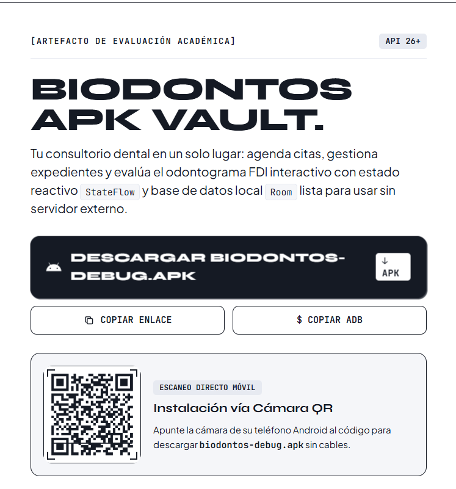
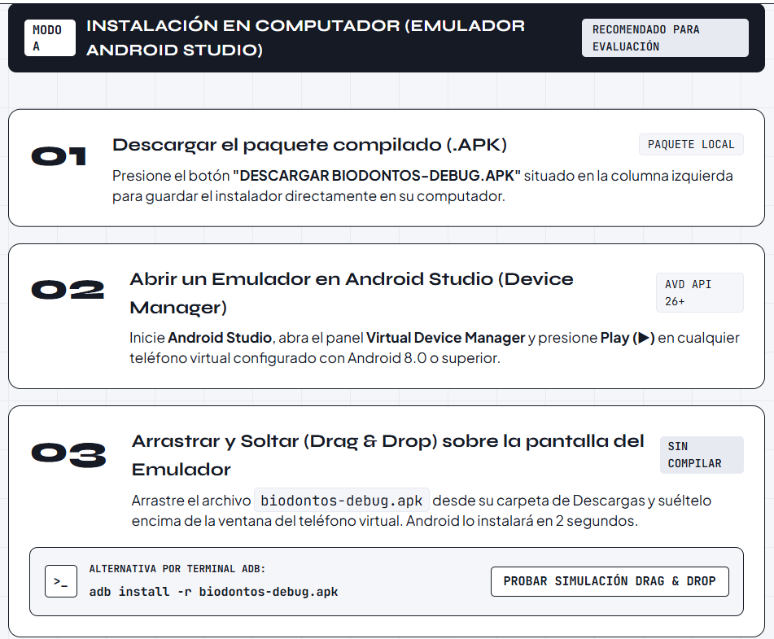
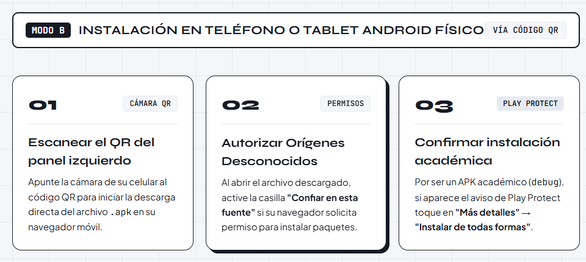

# 🦷 Biodontos — Plataforma Clínica Odontológica (Android)

Aplicación móvil clínica odontológica desarrollada en **Kotlin**, **Jetpack Compose (Material 3)** y **Supabase (PostgreSQL + PostgREST + GoTrue Auth)** bajo **Clean Architecture + MVI/MVVM**.

Incluye dos portales integrados:
* **Portal de Doctores:** Gestión de pacientes, admisión clínica con anamnesis y firma digital de consentimiento informado, odontograma interactivo FDI, periodontograma de 6 sitios, historia clínica y evoluciones inmutables, catálogo de materiales clínicos (INVIMA), facturación/abonos y agenda médica.
* **Portal de Pacientes:** Búsqueda de especialistas, perfil y servicios de consultorio, agendamiento y reprogramación de citas con confirmación en 2 pasos, historial clínico y estado de cuenta.

---

## 📲 Descarga e Instalación Paso a Paso del APK

Puedes descargar e instalar la última versión del APK directamente desde el portal oficial de despliegue (**Biodontos APK Vault**):

👉 **[Descargar APK de Biodontos — https://biodontosdeploy.vercel.app/](https://biodontosdeploy.vercel.app/)**



---

### 💻 Modo A: Instalación en Computador (Emulador Android Studio — Recomendado para Evaluación)



1. **Descargar el paquete compilado (`.APK`):** Presiona el botón **"DESCARGAR BIODONTOS-DEBUG.APK"** en el portal para guardar el instalador en tu computador.
2. **Abrir un Emulador en Android Studio (`Device Manager`):** Inicia **Android Studio**, abre el panel **Virtual Device Manager** y presiona **Play (▶)** en cualquier teléfono virtual configurado con **Android 8.0 (API 26) o superior**.
3. **Arrastrar y Soltar (*Drag & Drop*) sobre la pantalla del Emulador:** Arrastra el archivo `biodontos-debug.apk` desde tu carpeta de Descargas y suéltalo encima de la ventana del teléfono virtual (o instala por terminal con `adb install -r biodontos-debug.apk`).

---

### 📱 Modo B: Instalación en Teléfono o Tablet Android Físico (Vía Código QR o Enlace Directo)



Al instalar el archivo `.apk` directamente en tu celular o tablet, sigue estos **3 pasos y recomendaciones prácticas**:

1. **Escanear el QR o abrir el enlace (Requisitos del celular):**
   * Apunta la cámara de tu celular al código QR del portal o entra a **[https://biodontosdeploy.vercel.app/](https://biodontosdeploy.vercel.app/)** para iniciar la descarga directa.
   * Funciona en cualquier teléfono o tablet con **Android 8.0 o superior** (`minSdk = 26`, compatible con más del 99% de los dispositivos actuales) y conexión a internet (Wi-Fi o datos móviles).
2. **Autorizar Orígenes Desconocidos:**
   * Al abrir el archivo descargado, activa la casilla **"Confiar en esta fuente" / "Instalar apps desconocidas"** si tu navegador o gestor de archivos solicita permiso para instalar paquetes.
3. **Confirmar instalación ante Google Play Protect:**
   * Por tratarse de un APK académico de distribución directa (`debug`), si aparece el aviso de Google Play Protect indicando que *"no reconoce al desarrollador"*, toca en **"Más detalles" → "Instalar de todas formas"**.

> 💡 **Nota sobre actualizaciones:** Si tenías instalada una versión previa del APK compilada en otro equipo (con una firma de depuración distinta) y Android muestra el mensaje *"No se instaló la app (conflicto de paquete)"*, **desinstala primero la versión anterior** del teléfono antes de instalar el nuevo APK.

---

## 🔐 Credenciales de Prueba (Portal de Doctores)

* **Correo:** `cmendoza@biodontos.com`
* **Contraseña:** `Clinica2026*`
* **Rol:** `DOCTOR` (*Dr. Carlos Mendoza — Odontología General & Rehabilitación Oral*)

---

## 🏗️ Arquitectura y Compilación Local

El proyecto consta de un único módulo Gradle (`:app`) organizado en cuatro capas (`core`, `domain`, `data`, `presentation`).

### Requisitos de compilación
* **JDK 17** (por ejemplo, el JBR incluido con Android Studio).
* **Android SDK 35** (`compileSdk = 35`, `targetSdk = 35`, `minSdk = 26`).

```powershell
# Configurar JAVA_HOME en PowerShell (Windows)
$env:JAVA_HOME='C:\Program Files\Android\Android Studio\jbr'

# Ejecutar suite de pruebas unitarias JVM
./gradlew testDebugUnitTest

# Generar APK de depuración
./gradlew assembleDebug
```

El archivo APK compilado localmente se genera en:
`app/build/outputs/apk/debug/app-debug.apk`
